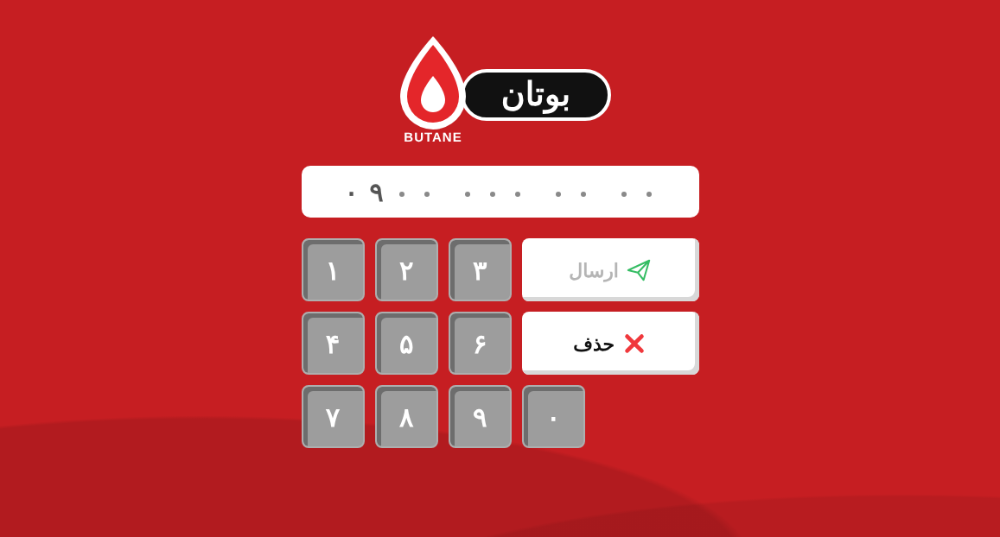
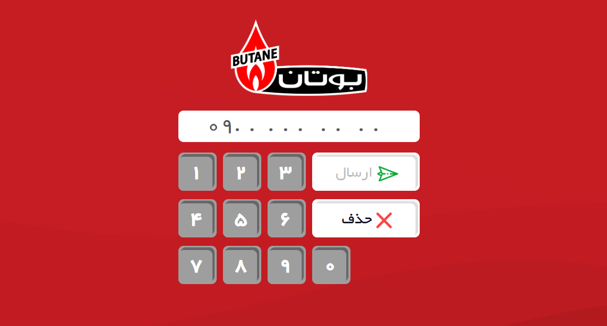

# Butane Keypad

A Persian (RTL) mobile-number keypad, rebuilt with **React 19 + Vite + TypeScript** and managed with **yarn**.

**Live demo:** https://github.com/zahrahaghjo/ExhibitionKeypad.git



<details>
<summary>Original design (for comparison)</summary>



</details>

## Features

- Persian digits (۰–۹) on the keys and in the display, with the number grouped as `۰۹۱۲ ۳۴۵ ۶۷ ۸۹`
- Fixed `09` prefix; the remaining positions show as dots until typed
- **ارسال** (send) is enabled only for a complete 11-digit Iranian mobile number
- **حذف** (delete) removes the last digit (never the `09` prefix)
- Physical keyboard support: Latin / Persian / Arabic digits, Backspace, Enter
- Responsive, accessible (labelled buttons, focus rings, `aria-live` status), reduced-motion friendly
- Unit-tested number logic (Vitest) and automatic GitHub Pages deploys

## Getting started

```bash
yarn install
yarn dev          # http://localhost:5173
yarn test         # unit tests
yarn build        # type-check + production build into dist/
yarn preview      # serve the production build
```

## Regenerate the preview screenshots

```bash
npx playwright install chromium   # first time only
yarn build
yarn screenshot                   # writes docs/preview.png and docs/preview-filled.png
```

## Customise

- **Logo:** replace `src/assets/logo.svg` with your real logo (SVG or PNG; update the import in `src/components/Logo.tsx` if you change the file name). The bundled one is a placeholder.
- **Colours / sizes:** CSS variables at the top of `src/styles.css`.
- **Submit action:** `handleSend` in `src/App.tsx` is where to call your API or SMS service.

## Project structure

```
src/
  App.tsx                  state, keyboard handling
  components/              Logo, PhoneDisplay, Keypad
  lib/phone.ts             digit conversion, validation, formatting
  lib/phone.test.ts        Vitest unit tests
  styles.css
scripts/screenshot.mjs     Playwright screenshot generator
.github/workflows/         GitHub Pages deployment
```

## Author

Zahra Haghjo · [LinkedIn](https://www.linkedin.com/in/zahrahaghjo) · [GitHub](https://github.com/zahrahaghjo)
